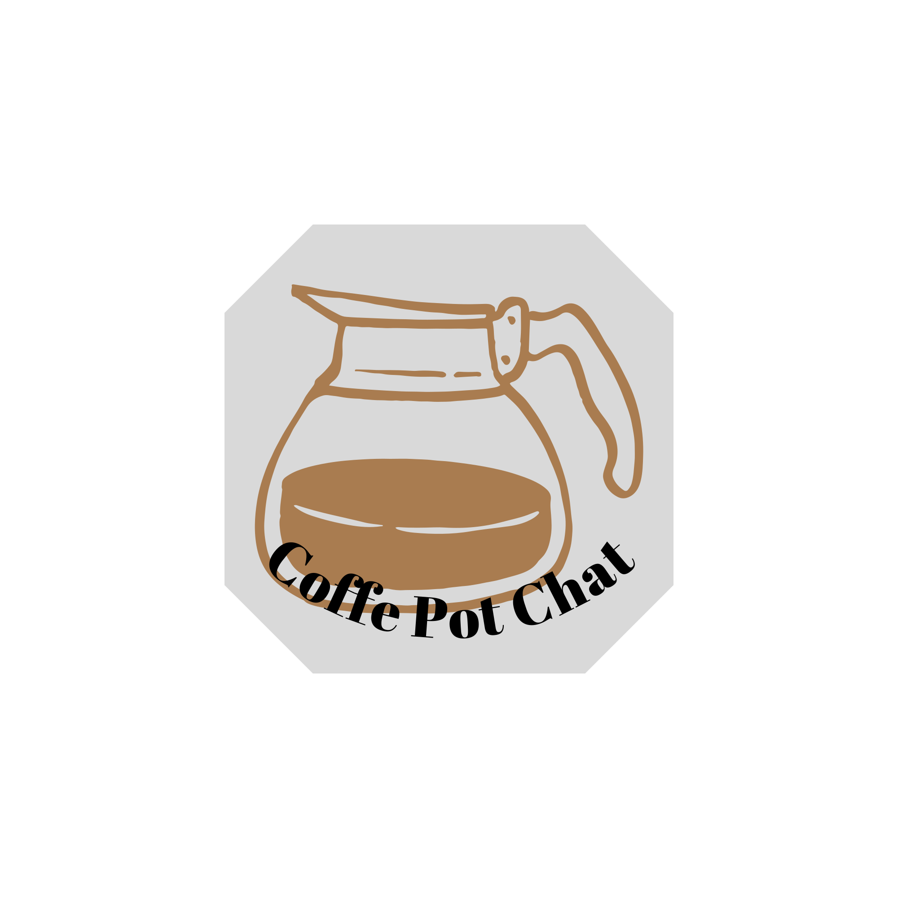

# CoffePotChat

CoffePotChat is a simple TCP messaging application written in Go
## Badges

[](http://www.gnu.org/licenses/agpl-3.0)


<div align="center">

  


## Run Locally

For run
```bash
  git clone https://link-to-project
```


